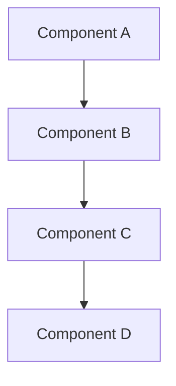

# 🏗️ ARCHITECTURE CONTEXT
**Task**: [Task Name]  
**Date**: [YYYY-MM-DD]  
**Agent**: Architecture  
**Phase**: Architecture (15% of timeline)

## 🗺️ Current System Overview
<!-- High-level view of existing architecture -->

### System Components

### Technology Stack
- **Frontend**: 
- **Backend**: 
- **Database**: 
- **Infrastructure**: 
- **External Services**: 

## 🔗 Integration Points
<!-- How does this task fit into existing systems? -->

### Upstream Dependencies
- **System/Service**: Description of dependency
- **Interface**: API/Protocol used
- **Data Flow**: Input requirements

### Downstream Dependencies  
- **System/Service**: Description of dependency
- **Interface**: API/Protocol used
- **Data Flow**: Output provided

### Side Dependencies
- **System/Service**: Description of dependency
- **Interface**: Shared resources/databases

## 📊 Data Architecture
<!-- Information flow and storage -->

### Data Sources
- **Source 1**: Type, Format, Volume
- **Source 2**: Type, Format, Volume

### Data Transformations
- **Transformation**: Input → Process → Output

### Data Storage
- **Storage Type**: Database/File/Cache
- **Schema**: Structure description
- **Access Patterns**: Read/Write patterns

## ⚡ Performance Characteristics
<!-- Current system behavior -->

### Scalability Patterns
- **Horizontal**: How system scales out
- **Vertical**: How system scales up
- **Bottlenecks**: Known limitations

### Performance Metrics
- **Response Time**: Current averages
- **Throughput**: Requests/transactions per unit
- **Resource Usage**: CPU/Memory/Disk/Network

## 🔒 Security & Compliance
<!-- Security considerations -->

### Authentication & Authorization
- **Auth Method**: How users authenticate
- **Permissions**: Role-based access control
- **Session Management**: How sessions are handled

### Data Protection
- **Encryption**: At rest and in transit
- **PII Handling**: Personal data protection
- **Compliance**: Relevant regulations (GDPR, etc.)

## 🧩 Modularity & Extensibility
<!-- How flexible is the current system? -->

### Module Boundaries
- **Clear Interfaces**: Well-defined APIs
- **Loose Coupling**: Independent components
- **High Cohesion**: Related functionality grouped

### Extension Points
- **Plugin Architecture**: How to add new features
- **Configuration**: Runtime customization
- **Integration Hooks**: External system connections

## 🚨 Architectural Risks
### 🔴 Critical Architectural Issues
- **Issue**: Description
  - **Impact**: System failure/data loss
  - **Urgency**: Immediate attention required

### 🟡 Major Architectural Concerns
- **Concern**: Description
  - **Impact**: Performance/maintainability issues
  - **Timeline**: Should address soon

### 🟢 Minor Architectural Notes
- **Note**: Description
  - **Impact**: Minor improvements possible
  - **Priority**: Nice to have

## 🎯 Architectural Recommendations
1. **Recommendation 1**: Specific architectural change
   - **Benefit**: Expected improvement
   - **Effort**: Implementation complexity
   - **Timeline**: Estimated duration

2. **Recommendation 2**: Specific architectural change
   - **Benefit**: Expected improvement  
   - **Effort**: Implementation complexity
   - **Timeline**: Estimated duration

## 📋 Architecture Decisions
<!-- Key decisions made during analysis -->

### Decision 1: [Decision Title]
- **Context**: Why this decision was needed
- **Options**: Alternatives considered
- **Decision**: What was chosen
- **Rationale**: Why this option
- **Consequences**: Positive and negative outcomes

### Decision 2: [Decision Title]
- **Context**: Why this decision was needed
- **Options**: Alternatives considered  
- **Decision**: What was chosen
- **Rationale**: Why this option
- **Consequences**: Positive and negative outcomes

## 📋 Next Steps
- [ ] Step 1: Create SOLUTION_PLAN.md
- [ ] Step 2: Design implementation approach
- [ ] Step 3: Plan iterative development

---
**Duration**: [X hours]  
**Confidence**: [High/Medium/Low]  
**Ready for Planning Phase**: [Yes/No]
