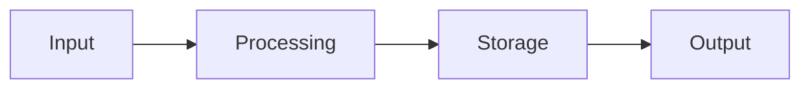

# 📋 SOLUTION PLAN
**Task**: [Task Name]  
**Date**: [YYYY-MM-DD]  
**Version**: 1.0  
**Agent**: Implementation  
**Phase**: Planning (40% of timeline)

## 🎯 Solution Overview
<!-- High-level approach to solving the problem -->

### Solution Strategy
- **Approach**: [Direct Implementation/Gradual Migration/Hybrid/etc.]
- **Methodology**: [Agile/Waterfall/M7 IDEAL/etc.]
- **Timeline**: [X weeks/months]
- **Priority**: [High/Medium/Low]

### Key Components
1. **Component 1**: Purpose and functionality
2. **Component 2**: Purpose and functionality  
3. **Component 3**: Purpose and functionality

## 🗓️ Implementation Phases
<!-- Break down into manageable phases -->

### Phase 1: Foundation
**Duration**: [X days/weeks]  
**Objectives**:
- [ ] Objective 1
- [ ] Objective 2
- [ ] Objective 3

**Deliverables**:
- [ ] Deliverable 1
- [ ] Deliverable 2

**Success Criteria**:
- [ ] Criterion 1
- [ ] Criterion 2

### Phase 2: Core Implementation  
**Duration**: [X days/weeks]  
**Objectives**:
- [ ] Objective 1
- [ ] Objective 2
- [ ] Objective 3

**Deliverables**:
- [ ] Deliverable 1
- [ ] Deliverable 2

**Success Criteria**:
- [ ] Criterion 1
- [ ] Criterion 2

### Phase 3: Integration & Testing
**Duration**: [X days/weeks]  
**Objectives**:
- [ ] Objective 1
- [ ] Objective 2
- [ ] Objective 3

**Deliverables**:
- [ ] Deliverable 1
- [ ] Deliverable 2

**Success Criteria**:
- [ ] Criterion 1
- [ ] Criterion 2

## 🛠️ Technical Implementation

### Technology Choices
- **Primary Language**: [Language + version]
- **Framework**: [Framework + version]
- **Database**: [Database + version]
- **External Services**: [APIs, libraries, etc.]

### Architecture Patterns
- **Pattern 1**: [MVC/Microservices/Event-driven/etc.]
  - **Rationale**: Why this pattern fits
  - **Implementation**: How it will be applied

### Data Flow

### API Design
- **Endpoint 1**: `GET /api/resource`
  - **Purpose**: What it does
  - **Parameters**: Required and optional
  - **Response**: Expected output format

- **Endpoint 2**: `POST /api/resource`
  - **Purpose**: What it does
  - **Body**: Required payload
  - **Response**: Expected output format

## 🧪 Testing Strategy
<!-- How will we validate the solution? -->

### Unit Testing
- **Framework**: [Jest/PyTest/etc.]
- **Coverage Target**: [%]
- **Key Areas**: What to focus on

### Integration Testing
- **Approach**: [API testing/E2E/etc.]
- **Tools**: [Playwright/Cypress/etc.]
- **Scenarios**: Critical user journeys

### Performance Testing
- **Metrics**: Response time, throughput, etc.
- **Tools**: [LoadRunner/JMeter/etc.]
- **Targets**: Acceptable performance levels

## 📦 Deployment Strategy
<!-- How will we release the solution? -->

### Environment Progression
1. **Development**: Local development setup
2. **Staging**: Pre-production testing
3. **Production**: Live environment

### Deployment Method
- **Strategy**: [Blue-Green/Rolling/Canary/etc.]
- **Automation**: CI/CD pipeline details
- **Rollback Plan**: How to revert if needed

### Configuration Management
- **Environment Variables**: What needs configuration
- **Secrets Management**: How sensitive data is handled
- **Feature Flags**: Gradual feature rollout

## 📊 Success Metrics
<!-- How will we measure success? -->

### Performance Metrics
- **Metric 1**: [Response time < 200ms]
- **Metric 2**: [Throughput > 1000 req/sec]
- **Metric 3**: [Error rate < 0.1%]

### Business Metrics
- **Metric 1**: [User adoption rate]
- **Metric 2**: [Task completion time]
- **Metric 3**: [Customer satisfaction]

### Technical Metrics
- **Code Quality**: [Cyclomatic complexity, maintainability]
- **Test Coverage**: [>95% line coverage]
- **Documentation**: [Complete API docs, user guides]

## 🚨 Risk Mitigation
<!-- How will we handle identified risks? -->

### Technical Risks
- **Risk**: [Database performance degradation]
  - **Mitigation**: [Connection pooling, query optimization]
  - **Contingency**: [Read replicas, caching layer]

### Operational Risks  
- **Risk**: [Deployment failure]
  - **Mitigation**: [Automated testing, staging validation]
  - **Contingency**: [Quick rollback procedure]

### Business Risks
- **Risk**: [User adoption resistance]
  - **Mitigation**: [User training, gradual rollout]
  - **Contingency**: [Feature toggles, feedback collection]

## 📋 Dependencies & Prerequisites
<!-- What needs to be in place first? -->

### External Dependencies
- [ ] **Service A**: API access and credentials
- [ ] **Library B**: Version compatibility verified
- [ ] **Database C**: Schema migration completed

### Internal Dependencies
- [ ] **Team X**: Design mockups completed
- [ ] **Team Y**: Infrastructure provisioned
- [ ] **Team Z**: Security review approved

### Prerequisites
- [ ] **Environment Setup**: Development tools installed
- [ ] **Access Rights**: Repository and system permissions
- [ ] **Documentation**: Requirements and specifications reviewed

## 🔄 Iteration Plan
<!-- How will we refine the solution? -->

### Iteration 1 (Week 1-2)
- **Goals**: MVP functionality
- **Features**: Core features only
- **Validation**: Basic functionality works

### Iteration 2 (Week 3-4)
- **Goals**: Enhanced features
- **Features**: Additional functionality
- **Validation**: User testing and feedback

### Iteration 3 (Week 5-6)
- **Goals**: Polish and optimization
- **Features**: Performance improvements
- **Validation**: Production readiness

## 📋 Next Steps
- [ ] Step 1: Create IMPACT_ANALYSIS.md
- [ ] Step 2: Assess risks and dependencies
- [ ] Step 3: Create IMPLEMENTATION_SIMULATION.md

---
**Duration**: [X hours]  
**Confidence**: [High/Medium/Low]  
**Ready for Impact Analysis**: [Yes/No]  
**Version History**: 
- v1.0: Initial plan created
